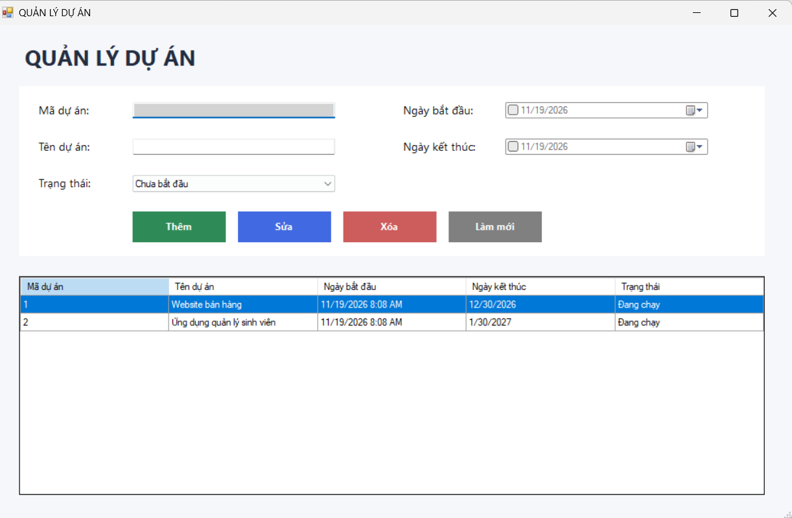
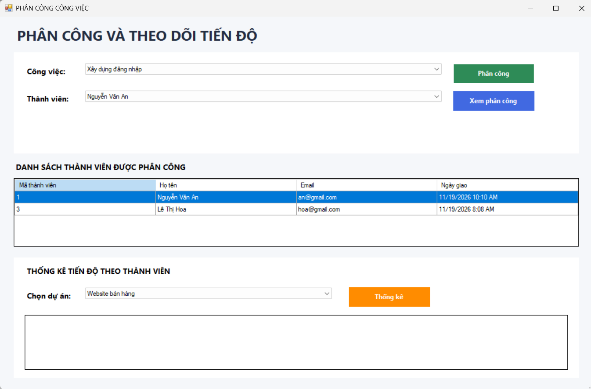
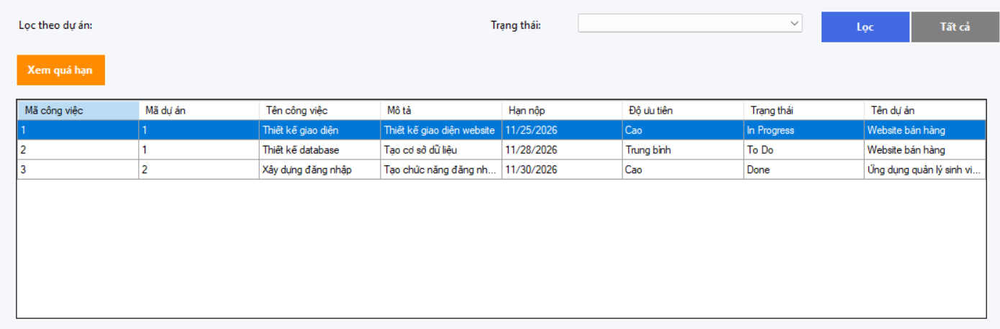
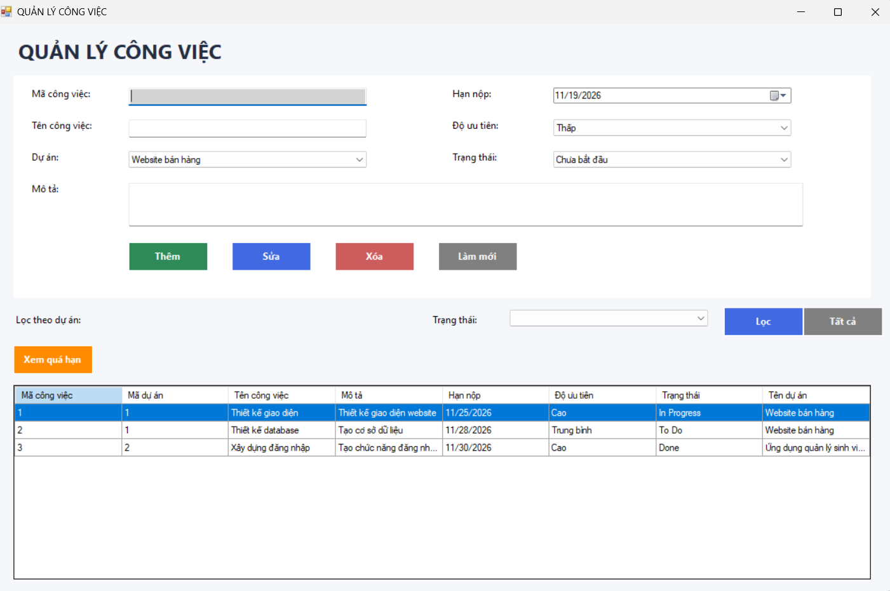
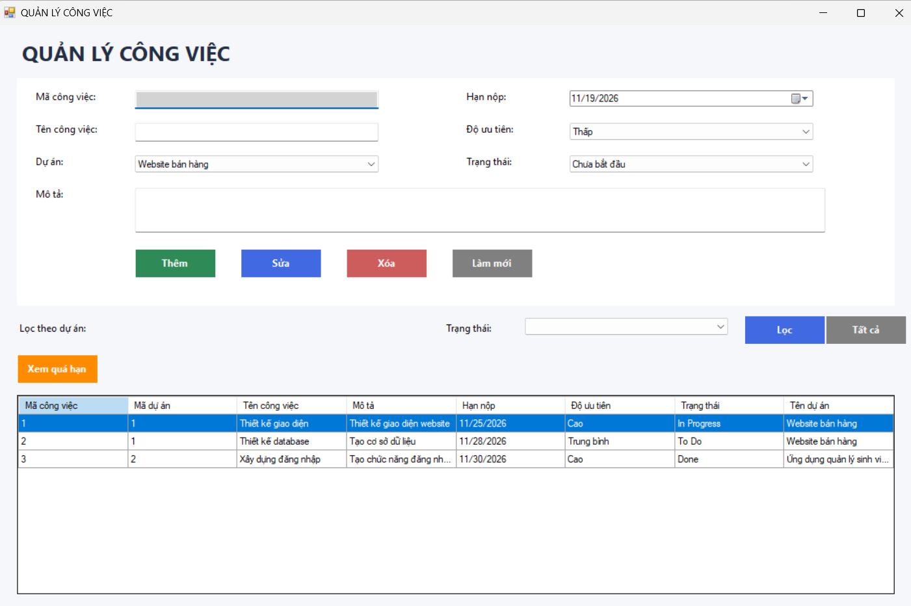

# BÁO CÁO THỰC HÀNH C# WINFORMS

## THÔNG TIN SINH VIÊN
- **Họ và tên:** Nguyễn Trường Giang
- **Mã số sinh viên:** 24810310200
- **Lớp:** D19CNPM3
- **Tên môn học:** Lập trình .NET
- **Nội dung:** bài tập thực hành 12-11

---

## KẾT QUẢ THỰC HÀNH
 

BÀI 6.3: HỆ THỐNG QUẢN LÝ CÔNG VIỆC & TIẾN ĐỘ DỰ ÁN  (PROJECT & TASK MANAGEMENT)  
**1. Quản lý Dự án & Task (3-Tier Layered):**
**o Thêm, sửa, xóa dự án và tạo công việc con thuộc dự án.**

---
# .NET-19-11
